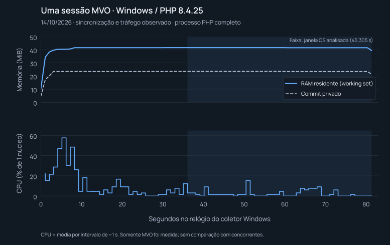

# Desempenho e benchmarks

Esta página publica uma medição real da MVO e a metodologia para compará-la com outras bibliotecas. Os concorrentes listados abaixo ainda não foram medidos neste ambiente; suas arquiteturas foram verificadas em fontes oficiais.

## Primeira medição

Em 14/10/2026, um processo PHP instrumentado, com uma sessão conectada no Windows, apresentou **41,67 MiB de RAM residente mediana** e **2,3797% de CPU média equivalente a um processador lógico** na janela após aquecimento. Foram 45,305 segundos de medição do processo, com tráfego leve e nenhuma mensagem de teste enviada.

| Medida na janela do sistema operacional após aquecimento | Resultado |
| --- | ---: |
| RAM residente do processo — Working Set, mediana | 41,67 MiB |
| Working Set, mínimo / máximo | 39,56 / 41,67 MiB |
| Memória privada comprometida — Private Commit, mediana | 23,60 MiB |
| Private Commit, mínimo / máximo | 21,47 / 23,60 MiB |
| Tempo de CPU consumido pelo processo | 1,07812 s |
| CPU média, equivalente a um processador lógico | 2,3797% |
| CPU média normalizada por 32 processadores lógicos | 0,07437% |

| Medida do alocador PHP | Resultado |
| --- | ---: |
| Memória usada na janela PHP após aquecimento | 9,292 MiB |
| Memória reservada pelo alocador na mesma janela | 12 MiB |
| Pico reservado durante toda a coleta PHP | 14 MiB |

As métricas do alocador usam uma janela PHP de 44,150 segundos, diferente da janela do sistema operacional. Os critérios, as definições e os limites da instrumentação estão em [Metodologia da coleta](#metodologia-da-coleta).

## Curvas



O gráfico permite acompanhar a fase inicial e a janela após aquecimento. Os valores agregados devem ser lidos junto das amostras: um pico de início não representa a média da conexão, e uma coleta curta não demonstra estabilidade por horas ou dias.

## Dados auditáveis

Esta coleta precede a atualização do subsistema de chamadas revisada no mesmo dia. Os hashes identificam o snapshot que foi medido; os arquivos atuais podem conter mudanças posteriores. As amostras foram preservadas, e os números não são uma medição das novas funcionalidades de chamadas. Consulte [a cobertura atual](PARIDADE.md).

| Arquivo | Conteúdo |
| --- | --- |
| [Resumo JSON](benchmarks/2026-10-14/summary.json) | Ambiente, janelas, memória, CPU, contadores e resultado da sessão. |
| [Amostras do processo](benchmarks/2026-10-14/process-samples.csv) | Tempo decorrido, tempo acumulado de CPU, Working Set, memória privada e fase. |
| [Amostras PHP](benchmarks/2026-10-14/php-samples.csv) | Memória do alocador PHP, tempo conectado e contadores de mensagens/nós. |
| [Manifesto da coleta](benchmarks/2026-10-14/manifest.json) | Configuração, duração, identificação dos arquivos e informações para conferir a coleta. |
| [Hashes dos arquivos de runtime](benchmarks/2026-10-14/source-files.sha256) | Identificação SHA-256 de `src/` e `resources/` da distribuição medida; não é um commit Git. |
| [Gráfico SVG](benchmarks/2026-10-14/resource-usage.svg) | Curvas publicadas nesta página. |

Os scripts originais estão disponíveis: [probe PHP](benchmarks/2026-10-14/reproduce/session-resource-probe.php), [coletor PowerShell](benchmarks/2026-10-14/reproduce/measure-session.ps1) e [agregador Python](benchmarks/2026-10-14/reproduce/summarize-session-resources.py). O [verificador offline dos CSV](benchmarks/2026-10-14/reproduce/recalculate.py) permite conferir os agregados publicados sem conectar ao WhatsApp.

Na raiz do projeto, execute o verificador com Python, sem dependências externas:

```powershell
python docs/benchmarks/2026-10-14/reproduce/recalculate.py
```

Ele recalcula os agregados de RAM/CPU e contadores, confere as janelas, os campos numéricos finais e os hashes do manifesto. Ambiente, duração total do coletor e flags de vínculo/identidade são informações reportadas pelo coletor; não são inferidas dos CSV. Os hashes conferem a integridade dos arquivos, sem constituir certificação independente. O script [plot.py](benchmarks/2026-10-14/reproduce/plot.py) regenera o gráfico a partir das amostras e requer Matplotlib.

## Metodologia da coleta

Foi usada uma sessão `default` já vinculada, retomada sem QR e com identidades preservadas. O ambiente foi Windows, PHP 8.4.25, Xdebug desativado, OPcache CLI desativado e 32 processadores lógicos. O processo usou a biblioteca de produção com callbacks de contagem e gravação JSON Lines; esse trabalho de instrumentação está incluído nos números. O processo PowerShell observador não está incluído na RAM ou CPU do processo PHP.

O worker registrou **80,394 segundos desde `connected` antes de desconectar**. A amostra final registrou 80,405 segundos desde esse evento, incluindo cerca de 11 ms após a desconexão. A execução PHP terminou em 81,292 segundos; o coletor do sistema operacional rodou por 82,379 segundos e obteve 80 amostras, com intervalo aproximado de um segundo. A duração do coletor inclui o encerramento e difere do intervalo entre a primeira e a última amostra, de aproximadamente 81,339 segundos.

Para separar o aquecimento, o resumo aplica o corte de `connected + 35 segundos`. As amostras do sistema operacional selecionadas vão de 36,036476 a 81,341502 segundos no relógio desse coletor: **45,305026 segundos, com 45 amostras**. Os snapshots PHP selecionados cobrem outra janela, de 37,130 a 81,280 segundos no relógio PHP: **44,150 segundos, com 40 snapshots**, de um total de 77.

O relógio PHP começa dentro do interpretador, e o do coletor começa após iniciar o processo. O deslocamento entre essas origens não foi capturado; o mesmo corte numérico foi aplicado aos dois. Por isso, as duas janelas não devem ser tratadas como intervalos perfeitamente alinhados.

Na janela PHP houve dois eventos `message` e 135 nós de protocolo. Portanto, a coleta representa uma conexão com tráfego leve, e não inatividade absoluta. No teste inteiro foram observados 276 eventos `message` e 2.124 nós, incluindo sincronização inicial. Esses contadores podem incluir replay e mensagens da própria conta (`fromMe`); não equivalem a novas mensagens recebidas nem a uma taxa de throughput.

Working Set mede as páginas residentes do processo, incluindo páginas privadas e compartilhadas. Private Commit foi coletado por `PrivateMemorySize64`, equivalente ao contador Private Bytes no Windows; não é uma medida de RAM privada residente. As definições estão nas referências Microsoft de [WorkingSet64](https://learn.microsoft.com/en-us/dotnet/api/system.diagnostics.process.workingset64?view=net-9.0) e [PrivateMemorySize64](https://learn.microsoft.com/en-us/dotnet/api/system.diagnostics.process.privatememorysize64). O Working Set de um processo com uma sessão não representa o custo marginal de adicionar outra sessão.

As métricas PHP descrevem o alocador da linguagem, sem representar toda a memória do processo. O valor reservado inclui páginas não usadas pelo código naquele instante; alocações fora do mecanismo PHP não entram nesse contador. Veja [memory_get_usage no manual PHP](https://www.php.net/manual/en/function.memory-get-usage.php). Esses valores não devem ser somados ao Working Set. Uma unidade MiB corresponde a 1.048.576 bytes.

A CPU é calculada por `100 × tempo de CPU / tempo decorrido`. Nessa escala, 100% equivale a ocupar um processador lógico durante toda a janela. Dividir por 32 expressa a parcela da capacidade lógica da máquina usada pelo processo; não mede o consumo total dos outros programas do PC.

| Fase | Janela medida | CPU média, um processador lógico | Maior intervalo amostrado de aproximadamente 1 s |
| --- | ---: | ---: | ---: |
| Inicial | 15,441 s | 22,3639% | 57,692% |
| Após aquecimento | 45,305 s | 2,3797% | 15,358% |

A fase inicial compreende a abertura do processo e aproximadamente os primeiros 15 segundos após `connected`. **Os 15,441 segundos são a duração dessa janela, não o tempo necessário para fazer login.** Os picos da tabela são médias entre amostras; não são valores instantâneos e não capturam necessariamente picos mais curtos que o intervalo do coletor.

## Comparação com outras bibliotecas

A tabela distingue consumo medido de arquitetura documentada. **N/D significa não medido, nunca zero.** As revisões das fontes abaixo foram consultadas em 14/10/2026; identificam o código analisado, sem afirmar que são a versão mais recente em qualquer data futura.

| Biblioteca | Arquitetura documentada | RAM medida | CPU média, um processador lógico | Evidência |
| --- | --- | --- | --- | --- |
| MVO PHP | Cliente PHP com WebSocket, Noise e Signal; sem navegador para a conexão. | Working Set mediano: 41,67 MiB; Private Commit mediano: 23,60 MiB. | 2,3797% | Medido na janela de 45,305 s descrita acima; [dados da coleta](benchmarks/2026-10-14/summary.json). |
| Baileys | TypeScript/Node.js com conexão WebSocket direta, sem exigir navegador. | N/D | N/D | Não medido neste ambiente. [README oficial, revisão `0af2386`](https://github.com/WhiskeySockets/Baileys/blob/0af2386292907f7d9742d8d41f830d8c48208fa1/README.md). |
| whatsapp-web.js | Node.js com Puppeteer e WhatsApp Web em Chrome/Chromium. | N/D | N/D | Não medido neste ambiente. [README oficial, revisão `064a3d5`](https://github.com/wwebjs/whatsapp-web.js/blob/064a3d5a5a3dce1281a6a12740b5a7051339d154/README.md). |
| whatsmeow | Go com implementação do protocolo multi-device e transporte WebSocket direto. | N/D | N/D | Não medido neste ambiente. [README oficial, revisão `f16f9ca`](https://github.com/tulir/whatsmeow/blob/f16f9ca30d6ae7ff35de7a02d94c93d3ae959098/README.md) e [transporte WebSocket](https://github.com/tulir/whatsmeow/blob/f16f9ca30d6ae7ff35de7a02d94c93d3ae959098/socket/framesocket.go). |
| WPPConnect | Node.js com Puppeteer e Chrome/Chromium, com opções de criação ou conexão ao navegador. | N/D | N/D | Não medido neste ambiente. [Implementação oficial do navegador, revisão `1ada250`](https://github.com/wppconnect-team/wppconnect/blob/1ada25070496db1dfc117f1062d6fb6cb47cf599/src/controllers/browser.ts). |

Essas diferenças de arquitetura, isoladamente, não comprovam qual biblioteca usa menos RAM ou CPU. Não há resultado experimental equivalente para os concorrentes nesta coleta, nem base para um ranking ou para afirmar que a MVO é determinada quantidade de vezes mais eficiente. Soluções com navegador podem reutilizar processos; não se deve presumir um navegador completo por sessão em toda configuração.

## Protocolo de reprodução

O probe usa o `WaClient` de produção sob instrumentação, com autenticação, criptografia e processamento normal de mensagens. Ele usa uma sessão já vinculada, encerra a execução dentro de um prazo e não envia mensagens de teste. O coletor mede o processo pelo sistema operacional; o agregador separa as janelas e calcula os resultados. A reprodução conecta ao serviço real e deve usar uma sessão autorizada, livre do lock de outro worker.

Os três scripts originais foram preservados sem alterações. Eles usam caminhos fixos: PHP em `C:/xampp/php/php.exe`, configuração `.dev/php.ini`, sessão `default` e saída `.cache/resource-probe-live`. O agregador original também fixa Windows, PHP 8.4.25 e 32 processadores lógicos em seus metadados; não deve ser usado para atribuir essas características a outra máquina.

Para repetir o procedimento original no ambiente descrito, use um checkout de teste isolado, prepare suas dependências e vincule uma sessão própria pelo fluxo normal. Copie os três scripts para `.cache/` com seus nomes originais e, na raiz do checkout, execute com PowerShell 7 e Python:

```powershell
pwsh -NoProfile -File .cache/measure-session.ps1
python .cache/summarize-session-resources.py
```

O coletor recusa iniciar se `.cache/resource-probe-live/php.jsonl` já existir. Preserve a coleta anterior e use outro checkout de teste em vez de sobrescrevê-la. Os dados arquivados em `docs/benchmarks/2026-10-14` não são o destino desses comandos. Não é necessário copiar bancos ou credenciais para verificar os CSV publicados.

Para uma comparação válida entre bibliotecas:

1. Fixe a revisão de cada biblioteca e registre as versões de PHP, Node.js, Go, navegador e dependências utilizadas.
2. Use a mesma máquina, sistema operacional, política de armazenamento, nível de logs e configuração de histórico/cache. Desative ferramentas de depuração nas execuções comparadas.
3. Separe abertura, sincronização e aquecimento da janela de tráfego medida. Registre quantidade de sessões, mensagens, nós ou eventos e operações realizadas, com a mesma carga para cada biblioteca.
4. Colete memória e CPU pelo sistema operacional, além das métricas de heap. Para soluções com navegador, inclua o runtime e os processos do navegador; documente processos compartilhados e o tratamento das páginas de memória compartilhadas.
5. Aplique a mesma fórmula de CPU e informe o número de processadores lógicos. Não compare um percentual normalizado pela máquina com outro normalizado por um único processador.
6. Repita as execuções e publique amostras, configuração, erros e critérios das janelas. Registre envio, recebimento, mídia ou chamadas como cenários separados.

Os arquivos desta página constituem uma primeira coleta da MVO, não a execução completa desse protocolo para todos os concorrentes.

## Limites

- Foi medida uma sessão e uma execução curta. Não é um teste com 60 sessões, um ensaio de carga ou uma prova de estabilidade prolongada.
- O ambiente foi Windows. Os valores não demonstram consumo equivalente em Ubuntu, contêineres ou outras configurações de PHP.
- Modelo de CPU, RAM física, build do Windows e carga de outros programas não foram registrados. Não houve uma execução sem instrumentação para isolar seu overhead.
- A janela final teve tráfego leve. Os contadores do teste inteiro incluem sincronização inicial e não representam throughput de novos envios.
- A medição não exercitou envio de mídia, conversão de arquivos, codecs, chamadas ou captura/reprodução de áudio e vídeo.
- Autenticação, criptografia, keepalive e processamento normal de protocolo fazem parte da conexão medida; consultas e tráfego de manutenção não tornam a conexão absolutamente inativa.
- Não foram medidos consumo de rede, latência de entrega, limite de sessões ou desempenho dos concorrentes. Esses resultados exigem coletas específicas.
